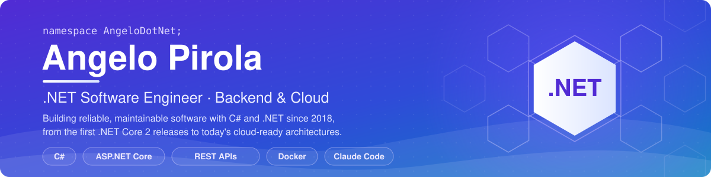

---

## 👋 About me

I'm a .NET software engineer focused on backend development and software architecture. I design clean APIs, integrate distributed services and share what I learn through open source projects and articles.

- 📍 Based in Varese, Italy · Italian, English
- 🔭 Building open source libraries and applications for .NET
- 📚 Learning Blazor and ASP.NET Core GraphQL, exploring AI-assisted development and local LLM tooling
- 🤝 Open to collaborations, pull requests are welcome
- 🔗 Find me:&nbsp;&nbsp;&nbsp;&nbsp;<a href="https://dev.to/angelodotnet"><picture><source media="(prefers-color-scheme: dark)" srcset="assets/icons/blog-dark.svg"></picture></a>&nbsp;&nbsp;&nbsp;&nbsp;&nbsp;&nbsp;&nbsp;&nbsp;<a href="https://twitter.com/intent/follow?screen_name=angeloit87"><picture><source media="(prefers-color-scheme: dark)" srcset="assets/icons/x-dark.svg"></picture></a>&nbsp;&nbsp;&nbsp;&nbsp;

---

## 🚀 Featured projects

| Project | Description |
|---|---|
| [**Wiki Documentation**](https://github.com/AngeloDotNet/wiki) | Docusaurus-based documentation hub for my projects and tools |
| [**ClaudeConfig**](https://github.com/AngeloDotNet/claude-config) | Starting repository for new projects developed with Claude Code |
| [**SagreEventi**](https://github.com/AngeloDotNet/sagreeventi) | Offline-first PWA for Italian food festivals, with a .NET backend |
| [**TinyDatabaseLocalization**](https://github.com/AngeloDotNet/TinyDatabaseLocalization) | Lightweight localization library for .NET applications, backed by a database |

> 📚 More repositories are available [here](https://github.com/AngeloDotNet?tab=repositories)

---

<!--
## 🔧 Tech stack

### Languages & frameworks

### Databases & messaging

### DevOps, quality & security

### APIs & collaboration

### Tools & AI

---
-->

## 📊 GitHub stats

<a href="https://github.com/AngeloDotNet">
  <picture>
    <source media="(prefers-color-scheme: dark)" srcset="https://github-profile-summary-cards.vercel.app/api/cards/profile-details?username=angelodotnet&amp;animation=sequence&amp;name=Angelo+Pirola&amp;theme=dracula">
    
  </picture>
</a>

---

## 📝 Latest blog posts

<!-- BLOG-POST-LIST:START -->
- [Claude config: rules and guardrails for Claude ... &lpar;Update: 14/11/2026&rpar;](https://dev.to/angelodotnet/claude-config-rules-and-guardrails-for-claude-update-14112026-393)
- [Claude config: rules and guardrails for Claude ... &lpar;Update: 10/11/2026&rpar;](https://dev.to/angelodotnet/update-10112026-claude-config-rules-and-guardrails-for-claude-4a6p)
- [Claude config: rules and guardrails for Claude Code on .NET + Angular projects](https://dev.to/angelodotnet/claude-config-rules-and-guardrails-for-claude-code-on-net-angular-projects-3o0p)
- [TinyLocalization: database-backend translations for .NET, without redeploying](https://dev.to/angelodotnet/tinylocalization-database-backed-translations-for-net-without-redeploying-2nd1)
- [SagreEventi: an offline-first app for Italian food festivals](https://dev.to/angelodotnet/sagreeventi-an-offline-first-app-for-italian-food-festivals-5fn5)
<!-- BLOG-POST-LIST:END -->
